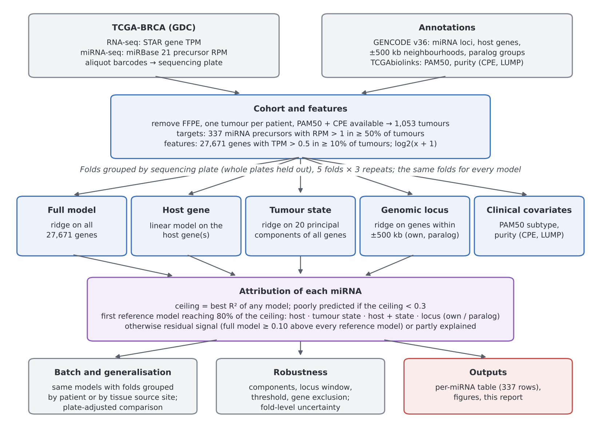
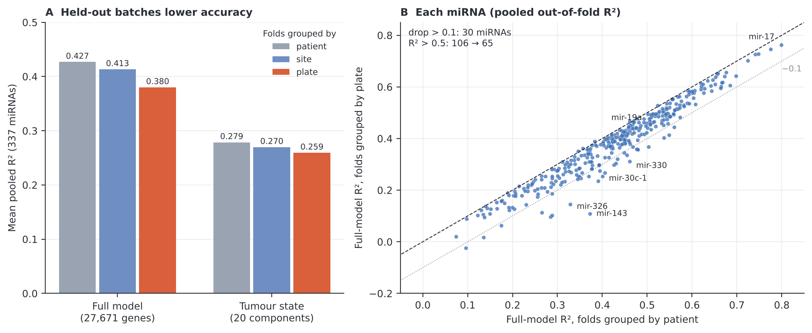
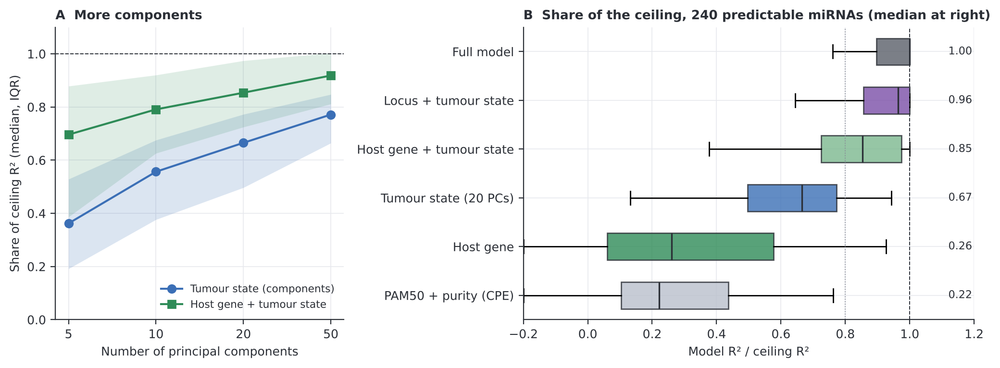
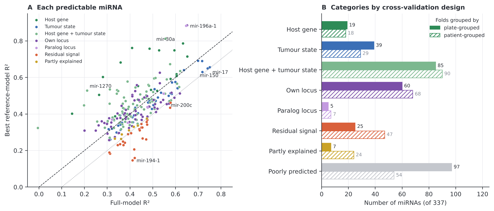

# What do mRNA-based predictions of microRNA expression measure?

An attribution analysis of 337 miRNA precursors in TCGA breast tumours.

MicroRNA (miRNA) levels are often estimated from mRNA expression when miRNA sequencing is not available. This project asks what such predictions capture. Each miRNA precursor is predicted from the whole transcriptome, and that prediction is compared, on the same cross-validation folds, with simpler reference models: the miRNA's host gene(s), the genes at its genomic locus, the leading principal components of the transcriptome (interpreted as tumour state) and clinical covariates. Because the mRNA and miRNA libraries of each tumour were sequenced on the same plates, the main analysis holds out whole sequencing plates.

**Full report:** [`report/mirna_prediction_attribution.pdf`](report/mirna_prediction_attribution.pdf)



## Main findings

- **Shared sequencing batches inflate standard cross-validation.** mRNA and miRNA plates are almost interchangeable (Cramér's V = 0.97). Holding out whole plates lowered the full model's mean R² from 0.427 to 0.380 (pooled out-of-fold) and the number of miRNAs with R² > 0.5 from 106 to 65. Holding out tissue source sites cost much less (0.413).
- **Most well-expressed miRNA precursors remain predictable.** With plate-grouped folds, 240 of 337 reached R² ≥ 0.3 with the best model (1,053 tumours, one per patient).
- **Simpler models reproduce most of the transferable performance.** Among the 240, 20 principal components reproduced a median of 67% of the best achievable R²; with host genes 85%; with host and local genes 96%. PAM50 subtype and purity reproduced 22%.
- **The components track tumour biology.** They correlate with ER/luminal, proliferation, basal, fibroblast, endothelial and lymphocyte programmes. One component (PC3) mainly tracks sequencing plate, but removing plate effects from both data types did not reduce the components' share (66% vs 64%).
- **Per-miRNA attribution.** At an 80% sufficiency threshold: host gene 19, tumour state 39, host gene + tumour state 85, own locus 60, paralog locus 5, residual signal 25 and partly explained 7; 97 were poorly predicted.
- **Half of the apparent miRNA-specific signal is batch-dependent.** Residual signal beyond all reference models fell from 47 miRNAs with patient-grouped folds to 25 with plate-grouped folds (for example mir-143: R² 0.37 → 0.01). The five robust residual-signal miRNAs are all paralogs (mir-181, mir-194).
- **Individual labels are uncertain.** 104 of the 240 labels are robust to locus window, gene exclusion and fold-to-fold variation (84 also across 10, 20 and 50 components); they are marked in the results table.
- **Paralogs.** For 17 of 32 paralogous precursors, genes at the paralog's locus predicted the precursor better than genes at its own locus (for example mir-196a-1: own locus R² 0.12, paralog locus 0.88). Precursor-level values of paralogs should not be read as locus-specific expression.

These comparisons identify sufficient predictive proxies, not causal mechanisms.

<p align="center">
  <br>
  <br>
  
</p>

## Repository layout

```text
README.md
report/
  mirna_prediction_attribution.pdf   full report
  make_figures.py                    figures from the tables in results/
  figures/
results/                             per-miRNA and summary tables used in the report (see results/README.md)
analysis/                            analysis scripts 01-27, run in numeric order (see analysis/README.md)
  run_all.sh                         runs every step in order
  export_results.py                  writes results/ from the analysis output; runs last
  external/gdc/file_aliquots.csv     aliquot barcodes (sequencing plates) of the analysis-set files
gdc_manifest.2026-08-17.143921.txt   GDC download manifest (TCGA-BRCA)
gdc_sample_sheet.2026-08-17.tsv      GDC sample sheet
environment.yml                      Python environment
environment-r.yml                    R environment (PAM50 and purity via TCGAbiolinks)
```

## Reproducing the analysis

1. **Environments**
   ```bash
   conda env create -f environment.yml      # Python analysis and figures
   conda env create -f environment-r.yml    # PAM50 and purity export
   ```
2. **Data.** Download the open-access TCGA-BRCA expression files listed in the manifest:
   ```bash
   gdc-client download -m gdc_manifest.2026-08-17.143921.txt -d data/raw
   ```
   Download the GENCODE v36 annotation (`gencode.v36.annotation.gtf.gz`) from [gencodegenes.org](https://www.gencodegenes.org) to `analysis/external/gencode_v36/`. Sequencing plates come from the aliquot barcodes; the GDC API result is included as `analysis/external/gdc/file_aliquots.csv`.
3. **Analysis.** From the repository root (about 4 hours):
   ```bash
   conda activate omics
   RSCRIPT="conda run -n r-env Rscript" bash analysis/run_all.sh
   ```
   This runs the scripts in `analysis/` in numeric order and finally `analysis/export_results.py`, which writes the tables in `results/`. See `analysis/README.md` for what each step does.
4. **Figures.** From the repository root:
   ```bash
   python report/make_figures.py
   ```

## Data

TCGA-BRCA expression data are openly available from the [Genomic Data Commons](https://portal.gdc.cancer.gov). PAM50 calls and purity estimates come from the TCGAbiolinks Bioconductor package. Raw data and intermediate matrices are not included in this repository.

## Author

Janaki Balasubramanian
